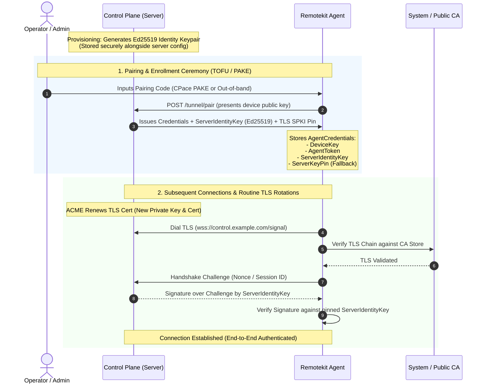

# Architectural Decision & Design: Server Key Pinning & Key Rotation

**Status:** Accepted / Design Specified  
**Related Issue:** [#69](https://github.com/barahn/remotekit/issues/69)  
**Parent Roadmap:** [Implementation Phases](implementation-phases.md) (Phase 0a)  
**Companion Documents:** [Decentralised Signalling & Untrusted Control Plane](decentralised-signalling.md), [HANDOFF.md](../HANDOFF.md)  
**Target Packages:** `tunnel`, `stream`, `osinfo`

---

## 1. Executive Summary

During Phase 0a (PR #17), `remotekit` introduced initial support for server public key pinning via `AgentCredentials.ServerKeyPin` and `tunnel/tlspin.go`. The implementation recorded the SHA-256 hash of the server certificate's `SubjectPublicKeyInfo` (SPKI) during agent enrollment.

However, enforcing this leaf key pin across all connections introduced a severe availability vulnerability (documented in issue #74):
1. **Automated ACME Certificate Renewals:** Modern automated certificate issuance (Let's Encrypt, Certbot, Caddy) generates a fresh private key and certificate pair on every renewal (every 60–90 days). Enforcing a single static leaf pin would cause a sudden, catastrophic fleet-wide disconnection requiring physical re-enrollment of every agent machine.
2. **Load Balancers and Multi-Instance Control Planes:** Enterprise deployments typically terminate TLS across multiple frontends or behind load balancers (e.g. AWS ALB, Cloudflare, HAProxy). Different backend nodes or CDNs often serve distinct TLS certificates with different leaf keys.
3. **Development and Air-Gapped Environments:** Self-signed servers relied on `BARAHN_INSECURE_SKIP_VERIFY=1`, which historically turned off certificate validation entirely.

This document formally records the architectural choice for **Issue #69**, resolving:
1. How a fleet survives leaf and root certificate rotations without re-enrollment.
2. How the server authenticates cryptographically to enrolled agents.
3. How `InsecureSkipVerify` can be safely eliminated outside automated test harnesses.

---

## 2. Evaluation of Architectural Options

Issue #69 proposed three primary approaches to evaluate:

### Option 1: Pinsets with Signed Rollover Pre-Announcements
* **Mechanism:** The agent persists a set of permitted public key hashes (current active key + pre-generated backup keys). When the server intends to rotate, it broadcasts a rollover statement (signed by the currently pinned key) announcing the successor key hash. Agents update their local pinset.
* **Evaluation:**
  - *Strengths:* Standard cryptographic pattern (analogous to HTTP Public Key Pinning [HPKP] and DNSSEC KSK rollover).
  - *Failure Modes:*
    - **Offline Agents:** If an agent remains offline or powered off throughout the entire transition window (e.g. employee on leave or backup device), it wakes up after the old key has been retired. The agent rejects the new key and is permanently orphaned ("bricked").
    - **Automated ACME Incompatibility:** ACME clients do not know their next private key months in advance unless configured with static key re-use (which defeats forward secrecy and key freshness). Co-ordinating external ACME daemons with a signed rollover API in `remotekit` creates brittle operational complexity.

### Option 2: Pin the Issuing CA or Intermediate Certificate
* **Mechanism:** Instead of pinning the server's leaf public key, the agent pins the SPKI hash of the issuing Intermediate CA or a private corporate Root CA.
* **Evaluation:**
  - *Strengths:* Leaf certificates can rotate arbitrarily without breaking agent connections, as long as they are signed by the pinned issuer.
  - *Failure Modes:*
    - **Public CA Instability:** Public CAs like Let's Encrypt frequently rotate their intermediate certificates (e.g. transitioning between R3, R4, E1, E2).
    - **Security Dilution:** Pinning a public intermediate (such as Let's Encrypt R3) permits *any* certificate issued by that intermediate for any domain if a misconfiguration occurs.
    - **Self-Hosted Complexity:** Requires self-hosted deployments to operate a dedicated internal Certificate Authority rather than using straightforward development certificates.

### Option 3 (Selected Architecture): Decouple Server Identity from TLS Transport
* **Mechanism:** Decouple transport-layer confidentiality from control-plane cryptographic identity:
  1. **Transport Layer (TLS):** Validated using standard X.509 CA verification (system trust store or custom enterprise CA bundle). Leaf certificates, ACME renewals, and multi-tenant CDN/load balancers operate normally without constraints on key re-use.
  2. **Application Layer (Server Identity):** The control plane possesses a dedicated, long-lived Ed25519 keypair (`ServerIdentityKey`), generated once when the control plane is provisioned. During enrollment, the server's public identity key is recorded in `AgentCredentials`.
  3. **Cryptographic Binding:** During the WebSocket / signalling handshake, the server signs an attestation binding its `ServerIdentityKey` to the transport session (using a mutual challenge-response nonce or TLS Channel Binding / Exporter value).
* **Evaluation:**
  - *Strengths:*
    - **Zero Outage on ACME Renewals:** TLS certificates can rotate hourly without affecting agent identity.
    - **Immunity to CDN/Load Balancer Divergence:** Front-facing edge proxies terminate TLS, while backend servers prove identity end-to-end to the agent.
    - **Architectural Symmetry:** Perfectly mirrors `remotekit`'s Phase 0 device identity model: the agent signs with its Ed25519 device key (`device.key`), and the server signs with its Ed25519 identity key (`server.key`).
    - **Clean Removal of `InsecureSkipVerify`:** Environments without public CAs anchor trust in the server's Ed25519 identity key via Trust-On-First-Use (TOFU) rather than disabling TLS verification globally.

---

## 3. Detailed Specification: The Decoupled Identity Model



### 3.1 Credential Model Updates

`AgentCredentials` in [`tunnel/client.go`](file:///home/fabio/Dev/remotekit/tunnel/client.go) is extended to store the server's identity key alongside the legacy transport pin:

```go
type AgentCredentials struct {
    AgentID      string `json:"agent_id"`
    AgentToken   string `json:"agent_token"`
    DeviceKey    string `json:"device_key,omitempty"`     // Agent's Ed25519 private key path
    ServerKeyPin string `json:"server_key_pin,omitempty"` // Legacy TLS SPKI SHA-256 pin

    // ServerIdentityKey is the base64-encoded Ed25519 public key representing
    // the authoritative identity of the control plane.
    ServerIdentityKey string `json:"server_identity_key,omitempty"`

    // CustomRootCA contains optional PEM-encoded root certificates for private PKIs.
    CustomRootCA string `json:"custom_root_ca,omitempty"`
}
```

### 3.2 Handshake Authentication Protocol

1. **Connection Initiation:** The agent connects over TLS (`wss://`).
2. **Challenge Exchange:**
   - Immediately upon WebSocket establishment (or within the initial HTTP Upgrade headers), the agent sends a 32-byte cryptographic nonce `client_nonce`.
   - The server computes:
     $$\text{Payload} = \text{"remotekit/server-auth/v1"} \parallel \text{client\_nonce} \parallel \text{server\_nonce} \parallel \text{agent\_id} \parallel \text{timestamp}$$
   - The server signs $\text{Payload}$ using its Ed25519 private key and returns the signature, `server_nonce`, and timestamp.
3. **Verification:**
   - The agent verifies the signature against `AgentCredentials.ServerIdentityKey`.
   - The timestamp must fall within $\pm 60$ seconds of the agent's clock.
   - If verification succeeds, the control plane session begins. If verification fails, the connection is aborted with `ErrServerIdentityMismatch`.

---

## 4. Server Identity Key Rotation Without Re-Enrollment

While the server's identity key is long-lived, organizations must be able to rotate it (e.g. routine cryptographic hygiene, planned server migration, or disaster recovery) without re-enrolling hundreds or thousands of agent machines.

### 4.1 Rotation via Signed Identity Transition Chains

To rotate the server identity from $K_{\text{old}}$ to $K_{\text{new}}$:
1. **Transition Statement Generation:**
   The control plane generates a signed transition certificate:
   ```json
   {
       "type": "server_identity_transition",
       "old_identity_key": "<K_old_public_hex>",
       "new_identity_key": "<K_new_public_hex>",
       "effective_at": 1780000000,
       "signature": "<Ed25519_signature_by_K_old>"
   }
   ```
2. **Online Propagation:**
   - Active agents receiving this statement verify that `signature` was generated by their currently pinned `K_old`.
   - Upon verification, the agent stores `K_new` as the primary key and keeps `K_old` as a retired fallback until `effective_at` has elapsed.
3. **Offline Agent Recovery:**
   - If an agent was offline during the rotation, when it reconnects to the server, the server presents the transition certificate during the initial handshake.
   - The offline agent validates the chain:
     $$\text{Pinned } K_{\text{old}} \xrightarrow{\text{Signed Statement}} K_{\text{new}}$$
   - The agent securely updates its stored credentials without administrator intervention.
4. **Revocation / Emergency Recovery:**
   - In the catastrophic event of a compromised $K_{\text{old}}$, out-of-band re-keying is executed via standard pairing code (`EnrollWithDeviceKey` or `pake.CPace`), binding the agent to the new server identity directly.

---

## 5. Deprecation & Restructuring of `InsecureSkipVerify`

### 5.1 The Threat Model of `InsecureSkipVerify`
Historically, `BARAHN_INSECURE_SKIP_VERIFY=1` completely disabled TLS certificate verification in `net/http` and `crypto/tls`. Even with the Phase 0a pin check (`tlspin.go`), if the pin was empty, the connection fell back to unauthenticated cleartext-equivalent transport:
```go
// Legacy tunnel/tlspin.go
if pin == "" {
    return &tls.Config{InsecureSkipVerify: true} // Connection is vulnerable to MITM
}
```

### 5.2 The New Verification Policy

| Environment | TLS CA Verification | Server Identity Verification | `InsecureSkipVerify` Permitted? |
|---|---|---|---|
| **Production (Public CA)** | Enforced via system root store | Enforced via `ServerIdentityKey` | **NO** |
| **Enterprise Fleet (Private PKI)** | Enforced via `CustomRootCA` | Enforced via `ServerIdentityKey` | **NO** |
| **Self-Hosted / Local Dev (No CA)** | Bypassed (Self-signed) | **Enforced via `ServerIdentityKey` (TOFU)** | Internal only, conditioned on valid pin/identity |
| **Automated Test Harnesses** | Configured via `httptest.Server.TLS` | Mocked / in-memory | **YES** (Test binaries only) |

### 5.3 Implementation Rules

1. **Compile-Time / Binary Separation:**
   - The environment variable `BARAHN_INSECURE_SKIP_VERIFY` is deprecated.
   - In production agent builds, `InsecureSkipVerify: true` without an explicit, non-empty pinned identity check is treated as a fatal configuration error.
2. **Cryptographic TOFU for Development:**
   - When connecting to a self-signed server without a valid CA, the agent requires `--trust-server-key=<pubkey_or_pin>` or records the identity key upon pairing.
   - Transport encryption is maintained, and man-in-the-middle attacks are prevented by the identity key, eliminating the "open door" vulnerability of unconditional skip-verify.

---

## 6. Implementation Roadmap & Downstream Impact

### 6.1 Phasing

1. **Documentation & Specification (Completed in #69):**
   - Architectural agreement recorded in this document.
2. **Core Implementation (Subsequent PR):**
   - Implement `ServerIdentityKey` exchange in `tunnel/server.go` and `tunnel/client.go`.
   - Implement handshake challenge verification in `stream/runner.go` / `tunnel/agent_stream.go`.
   - Update `tunnel/tlspin.go` to enforce non-empty identity validation.
3. **Downstream Adoption:**
   - **Chirp:** Uses `ServerIdentityKey` for self-hosted rendezvous relays and local control planes.
   - **Barahn:** Enterprise fleet deployment utilizes custom CA pools (`CustomRootCA`) for corporate TLS proxies while validating the platform identity key.

---

## 7. Summary

By decoupling control-plane cryptographic identity from transport-layer TLS certificates:
- Automated ACME certificate renewals operate smoothly without risking fleet-wide outages.
- Multi-region and multi-instance load balancers with distinct TLS certificates function without pin conflicts.
- Unpinned `InsecureSkipVerify` is eliminated outside test harnesses, replacing insecure bypasses with verified cryptographic Trust-On-First-Use.
